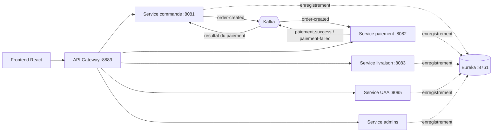

# Restaurant Platform

Plateforme de gestion de restaurants en **microservices Spring Boot**, avec une communication par événements **Kafka**, une découverte de services **Eureka**, une **API Gateway** et une interface web **React**.


## Architecture



| Module | Rôle |
|---|---|
| `EureukaServerRegistry` | Annuaire de services (Eureka) |
| `ApiGateway` | Point d'entrée unique, routage, disjoncteur Resilience4j |
| `back` | Service commande : publie `order-created`, écoute le résultat du paiement |
| `paiement` | Traite les commandes et publie `paiement-success` ou `paiement-failed` |
| `livraison` | Suivi des livraisons |
| `uaa-service` | Authentification et autorisation |
| `admins-services` | Administration de la plateforme |
| `frontend` | Interface React + TypeScript (Vite, Tailwind, shadcn/ui) |

## Le flux d'une commande

1. Le client passe commande : le service **commande** l'enregistre et publie `order-created`.
2. Le service **paiement** consomme l'événement, traite le paiement et publie `paiement-success` ou `paiement-failed`.
3. Le service **commande** met à jour le statut de la commande selon le résultat.

Les services ne s'appellent pas directement : ils restent découplés et peuvent évoluer séparément.

## Lancer le projet

Prérequis : Java 17, Maven, Docker.

```bash
# Tout lancer (services, Kafka, Zookeeper)
docker compose up -d --build

# Ou un service à la fois, en local
cd back && mvn spring-boot:run
```

| Adresse | Service |
|---|---|
| http://localhost:8761 | Tableau de bord Eureka |
| http://localhost:8889 | API Gateway |

Les services `back` et `paiement` attendent MySQL sur `localhost:3306` (voir `src/main/resources/application.properties`).

## Intégration et déploiement

- **Jenkins** (`Jenkinsfile`) : construction parallèle des services Maven puis des images Docker.
- **`deploy.sh`** : récupère le code, reconstruit et redémarre la plateforme avec Docker Compose.

## Ce que ce projet montre

Découpage en microservices, communication asynchrone par événements, découverte de services, passerelle d'API, conteneurisation et pipeline CI/CD.

---

Réalisé par **Stephanos Langate** · [Masseka Academy](https://www.youtube.com/@massekaacademy) · [LinkedIn](https://www.linkedin.com/in/stepnanos-l-988054114)
